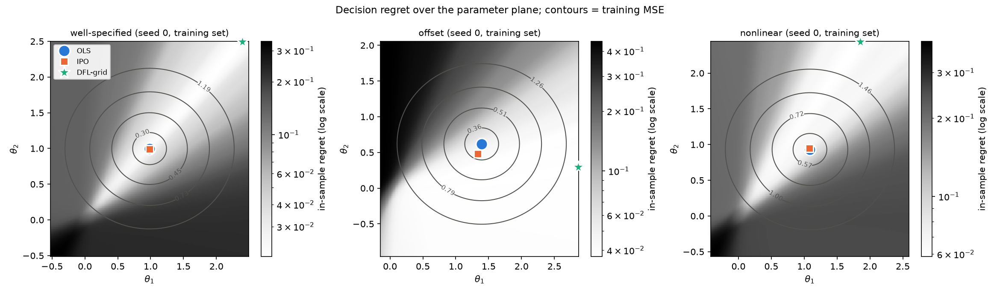

# dfl-portfolio

[](https://github.com/nuummm/dfl-portfolio/actions/workflows/ci.yml)

**What**: decision-focused learning (DFL) for long-only mean-variance portfolios: train a return predictor on the cost of the portfolio it induces instead of on squared error.
**How**: for two assets the portfolio has a closed form, so the decision cost can be minimised exactly by grid search (DFL-grid); a single-level KKT model (Pyomo; Bynum et al., 2021) for the general case is checked against that grid on small instances with Gurobi.
**Result**: on a two-asset synthetic problem whose misspecification an intercept cannot fix, DFL-grid has about 16% lower test regret than OLS with or without an intercept (lower in 16 of 20 seeds against each), at about 2.6x the test MSE. The KKT model is only compared in-sample and is not evaluated on test data here. When an intercept does fix the misspecification, or there is none, plain OLS-type fits are as good or better.

This is a cleaned, partial re-implementation of the code from my undergraduate thesis. Only the synthetic part is public. The thesis also compared SPO+ (Elmachtoub & Grigas, 2022) and a gradient-based IPO variant and evaluated the methods on real market data; none of that is included here.



*In-sample regret over the parameter plane (log scale, darker is worse) with training-MSE contours, seed 0 of each scenario. The low-regret region is a valley rather than a point, and the regret-minimising theta is not the MSE minimum. The DFL-grid star sits on the edge of the box in all three panels: along the valley the regret is nearly flat, so the location of the minimiser is weakly identified even where its decisions are not (see [formulation §6](docs/formulation.md#6-what-the-reference-can-and-cannot-check)).*

## Problem setup

At each period t, a linear model predicts asset returns from features, `yhat_t = x_t * theta` (element-wise, no intercept), and the portfolio is chosen by

```
w*(yhat, V) = argmin_{w >= 0, sum(w) = 1}  -(1 - delta) w'yhat + delta/2 w'Vw .
```

Training objectives:

| Objective | Definition |
|---|---|
| MSE | mean of `(yhat_t - y_t)^2` |
| Decision cost `L(theta)` | mean realised cost `-(1 - delta) w*'y_t + delta/2 w*'V_t w*` |
| Regret | `L(theta)` minus the cost of perfect-foresight portfolios `w*(y_t, V_t)` |

Synthetic data (`synthetic.py`): AR(1) features, `y_t = a * x_t + rho * b * g(x_t) + eps_t` with `b = (+1, -1)`. Three scenarios:

| Scenario | `g` | `rho` | Fixed by adding an intercept? |
|---|---|---:|---|
| well-specified | - | 0 | nothing to fix |
| offset | `1` | 0.5 | yes |
| nonlinear | `abs(x - mu_x) - E abs(x - mu_x)` (zero mean) | 2 | no |

A term along `(1, 1)` would not matter: under the budget constraint it shifts the cost of every portfolio by the same constant (tested).

Full derivations: [docs/formulation.md](docs/formulation.md).

## Methods

| Method | Module | Trains on | Notes |
|---|---|---|---|
| OLS | `models/linear.py` | MSE | asset-wise, closed form |
| IPO (closed form) | `models/ipo_closed_form.py` | decision cost with `w >= 0` dropped | Butler & Kwon (2023); a d x d linear solve whose solution does not depend on delta |
| DFL one-stage | `models/dfl_onestage.py` | in-sample decision cost, single nonconvex program | KKT (`kkt`) or zero-duality-gap (`dual`) single-level model; checked with Gurobi |
| DFL-grid | `models/dfl_grid.py` | in-sample decision cost, grid search over a bounded box | two assets only; uses the closed-form two-asset MVO, so it doubles as a solver-free reference |
| OLS + intercept | `models/baselines.py` | MSE | baseline with a larger model class (`yhat = alpha + x * beta`) |
| Best constant | `models/baselines.py` | decision cost | baseline that ignores the features: one fixed portfolio, chosen in-sample |

OLS, IPO and both DFL variants share the model `yhat = x * theta` without an intercept; the two baselines are there to check whether a gain is real.

## Quick start

```bash
uv sync
uv run python experiments/synthetic_demo.py     # roughly 10-15 s on a laptop CPU, no solver needed
uv run pytest
```

The one-stage model needs a nonconvex solver. With the `gurobipy` wheel (its bundled license limits model size, which T = 26 respects):

```bash
uv sync --extra gurobi
uv run pytest -m solver
uv run python experiments/solver_check.py
```

A Knitro wrapper is also included (set `KNITROAMPL` to the path of the `knitroampl` executable), but it was not run for any result in this repository.

## Results (synthetic, two assets)

From [results/table.md](results/table.md): delta = 0.5, 100 training and 2000 test periods per seed, 20 seeds, mean (standard deviation). "Interior" is the share of test periods in which the portfolio holds both assets. The last two columns count seeds with lower test regret than OLS and than OLS + intercept.

| scenario | method | test MSE | test regret | interior | < OLS | < OLS + int. |
|---|---|---:|---:|---:|---:|---:|
| well-specified | OLS | 0.251 (0.005) | 0.0424 (0.0030) | 0.19 | - | 11/20 |
| well-specified | OLS + intercept | 0.253 (0.006) | 0.0427 (0.0032) | 0.19 | 9/20 | - |
| well-specified | best constant | - | 0.1724 (0.0127) | 0.75 | 0/20 | 0/20 |
| well-specified | IPO | 0.257 (0.010) | 0.0425 (0.0028) | 0.19 | 11/20 | 11/20 |
| well-specified | DFL-grid | 1.731 (1.079) | 0.0450 (0.0032) | 0.15 | 1/20 | 2/20 |
| offset | OLS | 0.305 (0.009) | 0.0303 (0.0036) | 0.10 | - | 0/20 |
| offset | OLS + intercept | 0.253 (0.006) | 0.0205 (0.0024) | 0.07 | 20/20 | - |
| offset | best constant | - | 0.0332 (0.0039) | 0.00 | 4/20 | 0/20 |
| offset | IPO | 0.321 (0.033) | 0.0285 (0.0031) | 0.09 | 15/20 | 0/20 |
| offset | DFL-grid | 1.675 (0.536) | 0.0294 (0.0049) | 0.04 | 14/20 | 0/20 |
| nonlinear | OLS | 0.635 (0.027) | 0.1068 (0.0241) | 0.19 | - | 6/20 |
| nonlinear | OLS + intercept | 0.667 (0.055) | 0.1065 (0.0212) | 0.22 | 14/20 | - |
| nonlinear | best constant | - | 0.2346 (0.0161) | 0.70 | 0/20 | 0/20 |
| nonlinear | IPO | 0.748 (0.154) | 0.1073 (0.0210) | 0.23 | 12/20 | 7/20 |
| nonlinear | DFL-grid | 1.675 (0.834) | 0.0895 (0.0100) | 0.10 | 16/20 | 16/20 |

- **Nonlinear**: DFL-grid lowers test regret from 0.1068 (OLS) and 0.1065 (OLS + intercept) to 0.0895, about 16%, and is better than each in 16 of 20 seeds, while its test MSE is about 2.6x that of OLS. The intercept does not help here, and neither does the IPO closed form (0.1073), which ignores `w >= 0`.
- **Offset**: the no-intercept methods recover a little (IPO 0.0285, DFL-grid 0.0294 vs OLS 0.0303), but OLS + intercept, whose class contains the true model, reaches 0.0205 and beats all of them in every seed. If the model can be fixed, fixing it is better than changing the loss.
- **Well-specified**: OLS, OLS + intercept and IPO are within 0.0003 of each other. DFL-grid only overfits the 100 training periods (0.0450, better than OLS in 1 of 20 seeds).
- **The features matter**: the best constant portfolio is far worse in the well-specified and nonlinear scenarios (0.1724, 0.2346) and worse than OLS in 16 of 20 seeds in the offset scenario, so the decisions are not trivially "always hold one asset".
- **Most decisions are corners**: for the prediction-based methods only 4-23% of test periods have an interior portfolio, and DFL-grid has the fewest of them in every scenario. With two assets, most of what DFL changes is which asset to hold.
- The DFL-grid minimum lies on the edge of its box in 6, 9 and 8 of 20 seeds (well-specified, offset, nonlinear). Rerunning with `--scale 10` (a box about 3.3 times wider) makes the test MSE of DFL-grid roughly 8 to 11 times larger but changes its mean test regret by less than 0.001 in each scenario, so the regret numbers above are insensitive to the box size. The minimum still lies on the edge in 7, 4 and 3 of 20 seeds, and in the nonlinear scenario DFL-grid then beats OLS + intercept in 15 instead of 16 seeds.

The scatter of test MSE against test regret per seed is in [docs/figures/mse_vs_regret.png](docs/figures/mse_vs_regret.png).

**Solver check** ([results/solver_check.md](results/solver_check.md); Gurobi 13.0.3, T = 26, 5 seeds each of the well-specified and nonlinear scenarios, 60 s limit): the `kkt` model closed the optimality gap on all 10 instances (the slowest took 17 s), and its objective was never above the brute-force reference. It was up to 1.8e-2 below it (nonlinear, seed 0), where the optimum, theta = (9.54, 8.92), lies outside the grid's box; the other gaps to the reference come from a coarse or too small grid. The `dual` model closed the gap on only 2 of the 10 instances (7 hit the 60 s limit, 1 stopped with status `other`). Its objective equalled the `kkt` one on 8 instances and was worse than the reference on the other 2 (well-specified, seeds 0 and 4).

## Design decisions

- **No intercept in the shared class.** All decision-focused methods then learn the same d parameters, and with two assets the whole hypothesis class is the plane in the figure. OLS + intercept and the best constant portfolio are reported next to them so that a gain that only reflects a missing intercept, or a decision that ignores the features, is visible.
- **Brute-force reference instead of trusting the solver.** For d = 2 the lower-level MVO has a closed form, so `L(theta)` is exact anywhere. The grid always includes the OLS and IPO points, so the reference is never worse than them.
- **Compare objective values, not parameters.** `L` is flat wherever all decisions are corner portfolios, so the minimiser is not unique; on one instance the `dual` model returned theta = (454, 558) with the same objective as the `kkt` model's (2.8, 3.3).
- **Two single-level variants.** `kkt` puts all nonconvexity in T x d complementarity products. `dual` aggregates them into one quadratic equality per period. Both have the same feasible set; on these instances Gurobi handled `kkt` much better.
- **theta starts from the IPO solution.** It is cheap and already accounts for the decision problem. theta has no bounds in the one-stage model; bounding it (or using `lambda_anchor`) would likely help the `dual` variant but is not studied here.
- **Solvers are optional.** Gurobi is an extra and Knitro is found through an environment variable, so CI (Python 3.11 and 3.12) runs everything except the solver tests.

## What the tests check

| File | Checks |
|---|---|
| `test_problem.py` | simplex projection; the two-asset closed form matches projected gradient and a fine scan; a singular V gives a corner; delta -> 0 picks the best predicted asset; perfect foresight has zero regret; an offset along `(1, 1)` leaves every regret unchanged |
| `test_synthetic.py` | stationary mean, variance and lag-1 autocorrelation of the features; noise covariance; the nonlinear term has zero mean; reproducibility per seed |
| `test_baselines.py` | OLS + intercept matches `numpy.polyfit`; the best constant portfolio beats every fixed portfolio on a fine scan |
| `test_ipo_closed_form.py` | the affine decision satisfies the budget KKT conditions; the closed-form theta matches a numerical (BFGS) minimiser for several delta; independence of delta; invalid delta is rejected |
| `test_dfl_grid.py` | batched evaluation matches `problem.decision_cost`; the result is never worse than OLS or IPO; the grid covers the anchors; a boundary minimum is flagged with a warning and an interior one is not; grids smaller than 3 x 3 are rejected |
| `test_dfl_onestage.py` | variable and constraint counts (132 variables for T = 26); the closed-form lower-level solution plus its multipliers satisfies every constraint and reproduces `L(theta)` (no solver needed); with a solver (`-m solver`): the objective equals `L(theta)` and is no worse than the reference |

The solver tests are skipped automatically when neither Gurobi nor Knitro is available, and CI runs `pytest -m "not solver"`. They were run locally with Gurobi 13.0.3.

## Repository layout

```
src/dfl_portfolio/
  problem.py            mean-variance cost, two-asset closed form, projected-gradient oracle, regret
  synthetic.py          AR(1) features with an offset or a zero-mean nonlinear misspecification
  solvers.py            Gurobi / Knitro wrappers
  models/               linear (OLS), baselines, ipo_closed_form, dfl_grid, dfl_onestage
experiments/            synthetic_demo.py, solver_check.py
docs/                   formulation.md, figures/
results/                tables written by the experiments
tests/
```

## Limitations

- Synthetic data only, and the brute-force reference is limited to two assets.
- The nonlinear form and its strength were chosen to show a case that an intercept cannot fix. In exploratory runs, squared deviations gave a similar gain, while cubic, saturating and threshold terms did not let DFL-grid beat OLS + intercept. The gain above should not be read as general.
- The covariance is the true one and fixed over time; estimation error in `V` is not modelled.
- The one-stage model is nonconvex. With more periods or assets, Gurobi's global search slows down quickly, and Knitro only returns local solutions.
- DFL-grid has no regularisation, so it overfits when there is nothing to correct (well-specified scenario) and its theta is weakly identified. The `lambda_anchor` option of the one-stage model is the hook for this, but it is not studied here.
- The Knitro path is untested.
- Runtimes are from one laptop and are only indicative.

## References

- Butler, A., & Kwon, R. H. (2023). Integrating prediction in mean-variance portfolio optimization. *Quantitative Finance*, 23(3), 429-452. arXiv:2102.09287
- Elmachtoub, A. N., & Grigas, P. (2022). Smart "Predict, then Optimize". *Management Science*, 68(1), 9-26. arXiv:1710.08005
- Muñoz, M. A., Pineda, S., & Morales, J. M. (2022). A bilevel framework for decision-making under uncertainty with contextual information. *Omega*, 108, 102575.
- Scheel, H., & Scholtes, S. (2000). Mathematical programs with complementarity constraints: Stationarity, optimality, and sensitivity. *Mathematics of Operations Research*, 25(1), 1-22.
- Bynum, M. L., et al. (2021). *Pyomo: Optimization Modeling in Python* (3rd ed.). Springer.

## Acknowledgements

Thanks to my thesis advisor for supervising the research this code comes from.

## License

MIT. See [LICENSE](LICENSE).

---

**日本語の要約**: 卒業研究（Decision-Focused Learning × 平均分散ポートフォリオ）のコードを、合成データの部分だけ整理して書き直したものです。切片を足しても直せない誤指定のもとで、決定コストで学習した予測器（2 資産の総当たり探索）が OLS（切片あり・なし）より test regret を約 16% 下げる一方、切片で直せる誤指定では切片付き OLS の方が良いことも併せて示しています。予測の二乗誤差ではなく、その予測で組んだポートフォリオのコストで学習します。下位の最適化問題を KKT 条件で置き換えた一段化モデル（Pyomo）を、ソルバー不要の閉形式と総当たりの参照解で検証しています。上の数値はすべて、このリポジトリのスクリプトを実行して得たものです。
